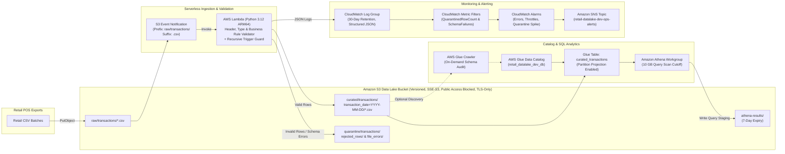

# Secure AWS Retail Data Lake with Terraform Infrastructure as Code

An event-driven, serverless AWS Data Lake foundation engineered for small and mid-sized retail operations. Defined in modular **Terraform**, the architecture ingests raw point-of-sale (POS) CSV files into **Amazon S3**, validates and transforms records deterministically via **AWS Lambda (Python 3.12)**, isolates malformed rows into a structured quarantine zone, catalogs Hive-partitioned datasets in the **AWS Glue Data Catalog** with **Athena Partition Projection**, enables cost-governed SQL analytics in **Amazon Athena**, and monitors pipeline health with **Amazon CloudWatch** alarms and **Amazon SNS**.

---

## 1. Business Objective & Problem Statement

A growing retailer generates daily CSV exports across multiple store locations (`STORE-001`, `STORE-002`, `STORE-003`). Historically, manual spreadsheet consolidation introduced silent formula errors, unvalidated negative quantities, duplicate transaction IDs, and unencrypted file sharing.

This project provides a secure, maintainable cloud data foundation that:
- **Blocks public exposure and enforces encryption** at rest (`SSE-S3` with Bucket Keys) and in transit (`aws:SecureTransport` TLS-only policy).
- **Automates event-triggered ingestion** when a CSV file lands in `raw/transactions/` while preventing accidental recursive re-triggering on `curated/` or `quarantine/` outputs.
- **Applies deterministic validation**: verifies required headers, data types, store/SKU formats, duplicate transaction IDs, and discount bounds (`discount_amount <= gross_amount`), routing valid records to Hive-partitioned `curated/transactions/transaction_date=YYYY-MM-DD/` and defective records to `quarantine/transactions/`.
- **Enables immediate SQL analytics** in Amazon Athena with a 10 GB per-query scan cap and zero-latency Partition Projection.
- **Provides operational observability** via structured JSON logs, CloudWatch metric filters, and SNS alarms.

---

## 2. Architecture Overview



### Architectural Trade-offs Chosen for a Small Retailer

1. **Single S3 Bucket with Strict Prefix & IAM Isolation vs. Multi-Bucket Topology**:
   Separating zones via well-governed prefixes (`raw/transactions/`, `curated/transactions/`, `quarantine/transactions/`, `athena-results/`) inside one encrypted, versioned bucket avoids cross-bucket IAM replication overhead while still allowing prefix-level IAM policies and tailored S3 Lifecycle rules per zone.
2. **AWS Lambda (`arm64`) vs. AWS Glue Spark ETL**:
   Retail CSV drops are typically megabytes, not terabytes. Lambda processes them in under a second within the AWS Free Tier, whereas Glue Spark jobs enforce minimum DPU billing windows and cold-start overhead.
3. **Glue Table with Athena Partition Projection vs. Scheduled Glue Crawler**:
   Partition Projection mathematically maps `transaction_date=YYYY-MM-DD` partitions on the fly so analysts can query newly ingested data immediately at $0 Crawler cost. An on-demand `aws_glue_crawler` is also provisioned in Terraform for optional schema audits.

---

## 3. S3 Bucket & Prefix Convention

| S3 Prefix | Purpose | Lifecycle Policy | IAM Write Access | IAM Read Access |
| :--- | :--- | :--- | :--- | :--- |
| `raw/transactions/` | Landing zone for incoming retail POS CSV files. Triggers S3 `ObjectCreated:*` notification. | Transition to `STANDARD_IA` at 30d, `GLACIER_IR` at 90d; noncurrent versions expire at 30d. | Upstream ingestion producer | `lambda-ingestion-role` only (Explicitly denied to Athena analysts) |
| `curated/transactions/` | Validated, normalized, and enriched CSV records partitioned by `transaction_date=YYYY-MM-DD/`. | Noncurrent versions expire at 30d. | `lambda-ingestion-role` only | `athena-analyst-readonly`, `glue-crawler-role` |
| `quarantine/transactions/` | Diagnostic JSON reports for rejected rows (`rejected_rows/`) and file-level header failures (`file_errors/`). | Expire current objects at 90d; noncurrent versions at 14d. | `lambda-ingestion-role` only | Operations / Data Engineering |
| `athena-results/` | Ephemeral staging area for Amazon Athena query execution outputs. | Expire objects at 7d; abort incomplete multipart uploads at 7d. | `athena-analyst-readonly` | `athena-analyst-readonly` |

---

## 4. Repository Structure

```text
aws-retail-datalake/
├── .env.example
├── .gitignore
├── pyproject.toml
├── requirements.txt
├── README.md
├── docs/
│   ├── architecture_and_security.md
│   ├── cost_and_operations.md
│   └── architecture_inspector.html
├── terraform/
│   ├── versions.tf
│   ├── variables.tf
│   ├── main.tf
│   ├── outputs.tf
│   ├── terraform.tfvars.example
│   └── modules/
│       ├── storage/
│       ├── iam/
│       ├── compute/
│       ├── catalog_analytics/
│       └── observability/
├── src/
│   └── ingestion_lambda/
│       ├── __init__.py
│       ├── schema.py
│       ├── validator.py
│       ├── transformer.py
│       ├── storage_adapter.py
│       └── handler.py
├── sql/
│   ├── 01_daily_store_revenue.sql
│   ├── 02_category_discount_performance.sql
│   ├── 03_payment_method_distribution.sql
│   ├── 04_hourly_basket_velocity.sql
│   └── 05_ingestion_audit_summary.sql
├── data/
│   └── sample_raw/
│       ├── retail_transactions_2026_10_28_valid.csv
│       ├── retail_transactions_2026_10_29_mixed.csv
│       └── retail_transactions_2026_10_30_malformed_headers.csv
├── scripts/
│   └── validate_pipeline.py
└── tests/
    ├── test_validator.py
    ├── test_transformer.py
    ├── test_handler_and_guards.py
    └── test_terraform_and_sql.py
```

---

## 5. Local Verification & Pipeline Demonstration

No live AWS credentials or cloud deployments are required to test the transformation logic, recursive trigger guards, quarantine error reporting, Athena SQL queries, or Terraform configuration validity.

### A. Run the End-to-End Local Pipeline & SQL Validator

```powershell
python scripts/validate_pipeline.py
```

What this script executes:
1. Stages the three sample retail CSV files (`valid`, `mixed`, and `malformed_headers`) into a local S3 mirror under `data/local_lake/retail-datalake-dev-123456789012/raw/transactions/`.
2. Invokes the exact `lambda_handler` (`src/ingestion_lambda/handler.py`) using realistic S3 `ObjectCreated:Put` event payloads.
3. Writes Hive-partitioned curated CSV files to `curated/transactions/transaction_date=YYYY-MM-DD/` and structured quarantine JSON reports to `quarantine/transactions/`.
4. Verifies that an event originating from `curated/transactions/...` is deterministically blocked by `RecursiveTriggerGuardError`.
5. Loads all curated partitions into an in-memory SQL table matching the Glue Catalog schema and executes all 5 Athena SQL queries in `sql/*.sql`.
6. Generates an interactive, cloud-console-styled verification report at `docs/architecture_inspector.html`.

### B. Run Automated Unit & Integration Tests

```powershell
pytest
```

### C. Run Terraform Formatting and Static Configuration Validation

```powershell
cd terraform
terraform fmt -check -recursive
terraform init -backend=false
terraform validate
```

---

## 6. Safe AWS Infrastructure Review & Authorized Deployment Guide

> **Safety Notice**: This repository never deploys cloud resources automatically or assumes active AWS credentials. All validation performed in this workspace is local static and functional verification.

When deploying to an authorized AWS account:

1. Copy the example variables file and customize for your target AWS account:
   ```powershell
   cd terraform
   Copy-Item terraform.tfvars.example terraform.tfvars
   ```
2. Configure your 12-digit `aws_account_id`, target `aws_region`, and optional `alert_email` in `terraform.tfvars`.
3. Initialize Terraform with your chosen state backend and inspect the execution plan before applying any changes:
   ```powershell
   terraform init
   terraform fmt -check -recursive
   terraform validate
   terraform plan -out=tfplan
   ```
4. Review the planned resources (S3 bucket, Public Access Block, SSE-S3 config, Lifecycle rules, TLS bucket policy, least-privilege IAM roles/policies, Lambda function + S3 notification filter, Glue Catalog database/table/crawler, Athena workgroup + named queries, and CloudWatch log group/metric filters/alarms).
5. Apply only when authorized:
   ```powershell
   terraform apply tfplan
   ```

---

## 7. Representative Athena SQL Queries

All 5 analytical queries in `sql/` are automatically registered as `aws_athena_named_query` resources in the `retail-datalake-dev-analytics-wg` Athena workgroup and verified locally against the curated partitions:

- **`sql/01_daily_store_revenue.sql`**: Daily gross revenue, discounts, net revenue, and average transaction value by store and partition date.
- **`sql/02_category_discount_performance.sql`**: Category-level unit volume, net sales, and effective promotional discount rate percentage.
- **`sql/03_payment_method_distribution.sql`**: Net volume, average ticket size, and percentage share of transactions across `CARD`, `MOBILE_PAY`, `CASH`, and `VOUCHER`.
- **`sql/04_hourly_basket_velocity.sql`**: Hourly transaction throughput and customer basket velocity in UTC.
- **`sql/05_ingestion_audit_summary.sql`**: Data lineage audit mapping each `source_file` and `transaction_date` partition to its curated row count and net revenue.

---

## 8. Detailed Documentation

- [Architecture, Security Controls, and Data Dictionary](docs/architecture_and_security.md)
- [Cost Governance and Operational Runbook](docs/cost_and_operations.md)
- [Local Architecture & Pipeline Verification Console (HTML)](docs/architecture_inspector.html)
